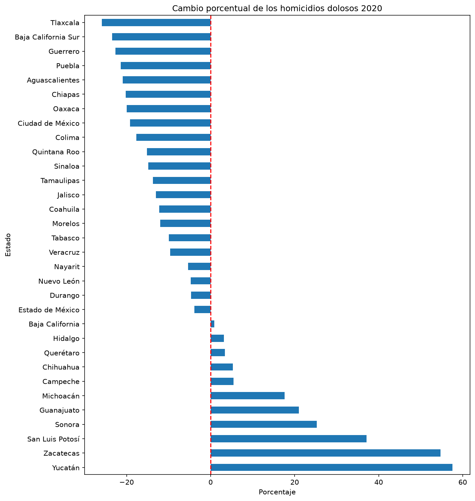

# Homicidio-doloso-en-Mexico-
¿Cómo cambió el homicidio doloso en México en 2020 respecto a 2019? Análisis por estado con pandas y matplotlib.

# Homicidio doloso en México, 2015-2021

¿Cómo cambió el homicidio doloso en México en 2020 respecto a 2019, a nivel nacional y por estado?

## Datos

- Fuente: [Secretariado Ejecutivo del Sistema Nacional de Seguridad Pública (SESNSP), incidencia delictiva estatal. https://www.datos.gob.mx/dataset/incidencia_delictiva]
- Fecha de descarga: [15/11/2026]
- Archivo: `INM_estatal_dic25.csv` (no incluido en el repositorio por su tamaño; descárgalo de la fuente y colócalo en la misma carpeta que el notebook)
- Unidad: carpetas de investigación, no víctimas

## Cómo correrlo

1. Instala las librerías: `pip install pandas matplotlib numpy`
2. Coloca el CSV junto al notebook.
3. Abre `homicidio_doloso_2015_2021.ipynb` y ejecuta todas las celdas de arriba abajo.

## Hallazgos

- A nivel nacional, el homicidio doloso pasó de 29,498 carpetas en 2019 a 28,839 en 2020 (−2.2%). En 2021 fue de 28,279 (−1.9% vs 2020).
- El total venía creciendo con fuerza hasta 2018 y se estancó en 2019 (+1.4%). La baja de 2020 es pequeña y se parece a la de 2021.
- Por estado, 21 de 32 entidades bajaron en 2020 y 11 subieron, con cambios de aproximadamente −26% (Tlaxcala) a +58% (Yucatán).

## Limitaciones

- Se miden carpetas de investigación, no víctimas ni delitos no denunciados.
- Los cambios porcentuales no consideran el tamaño del estado; en entidades con pocos casos, los extremos deben leerse con cautela.
- No hay ajuste por población.
- No se calculó el cambio absoluto por estado, así que no se sabe qué entidades explican la variación nacional.
- No se verificó si la serie 2015-2017 es comparable con la posterior.
- El análisis describe qué cambió, no por qué; no se puede atribuir a la pandemia.

## Herramientas

Python, pandas, NumPy, matplotlib.
